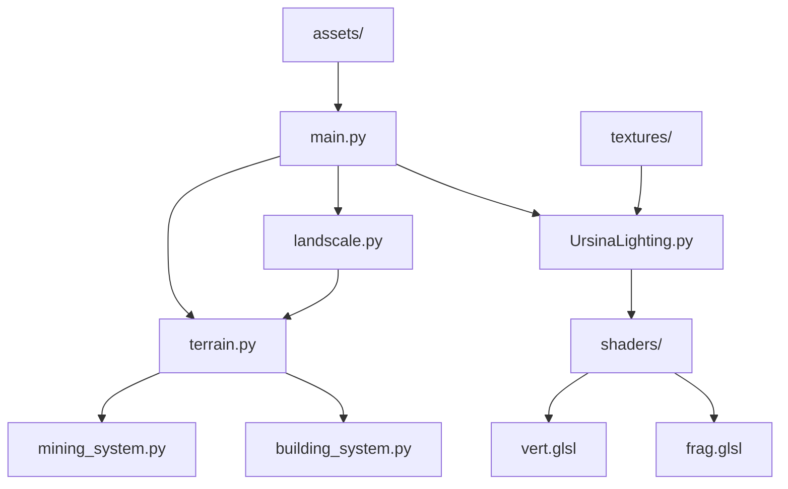
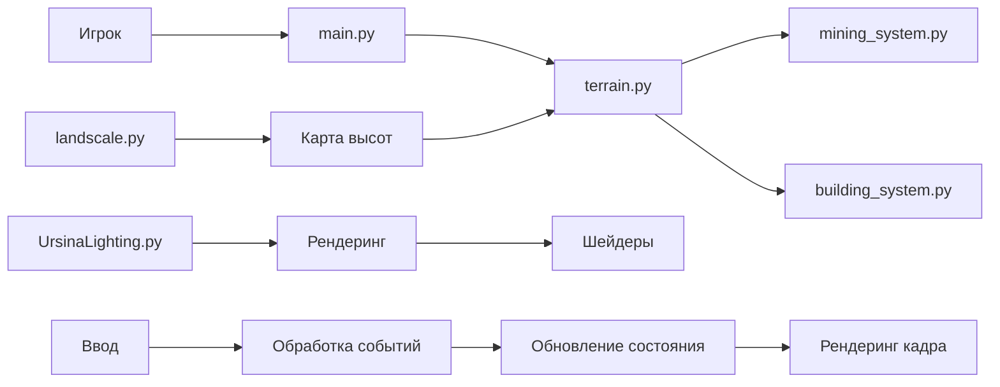
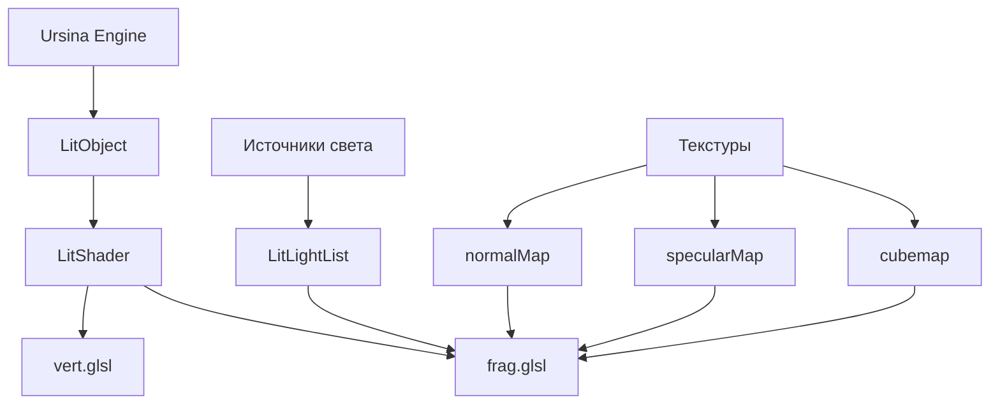

# Документация проекта Minecraft-подобной игры на Ursina

## 1. Структура проекта

```
ursina-habr-main/
├── main.py                 # Главный файл приложения
├── terrain.py              # Система генерации и управления террейном
├── landscale.py            # Генерация ландшафта с помощью шума Перлина
├── mining_system.py        # Система добычи блоков
├── building_system.py      # Система строительства блоков
├── UrsinaLighting.py       # Кастомная система освещения
├── assets/                 # Ресурсы игры
│   ├── arm.blend          # 3D модель руки игрока
│   ├── arm.obj            # Модель руки в формате OBJ
│   ├── arm_texture.png    # Текстура руки
│   ├── block.obj          # Модель блока
│   ├── texture_atlas.png  # Атлас текстур для блоков
│   ├── C418_Subwoofer_Lullaby.mp3  # Фоновая музыка
│   ├── step.ogg           # Звук шагов по траве
│   ├── water-swim.mp3     # Звук плавания в воде
│   └── punch_sound.wav    # Звук удара
├── textures/              # Текстуры и материалы
│   ├── skybox.jpg         # Текстура неба
│   ├── water_norm.png     # Нормальная карта воды
│   ├── rocks_diff.jpg     # Диффузная карта камня
│   ├── rocks_norm.exr     # Нормальная карта камня
│   ├── rocks_spec.jpg     # Карта бликов камня
│   └── cubemap_*.jpg      # Кубическая карта для отражений
└── shaders/               # GLSL шейдеры
    ├── vert.glsl          # Вершинный шейдер
    └── frag.glsl          # Фрагментный шейдер
```

## 2. Описание файлов

### 2.1 main.py
**Назначение:** Главный файл приложения, точка входа в игру.

**Ключевые компоненты:**
- Инициализация Ursina с полноэкранным режимом
- Создание игрока (FirstPersonController)
- Система звуков (фоновая музыка, шаги, плавание)
- Класс `Hand` - 3D модель руки игрока
- Основной игровой цикл с физикой движения

**Связи:**
- Импортирует все основные модули
- Создает экземпляры `Map`, `MeshTerrain`, `LitInit`
- Управляет обновлением террейна и физикой игрока

**Логика:**
```python
# Основной цикл обновления каждые 4 кадра
if count == 4:
    terrain.update(subject.position, camera)

# Звуковые эффекты при движении
if abs(subject.x-pX) > 1 or abs(subject.z-pZ) > 1:
    # Воспроизведение звуков шагов или плавания
```

### 2.2 terrain.py
**Назначение:** Система генерации и управления воксельным террейном.

**Ключевые классы:**
- `MeshTerrain` - основной класс управления террейном

**Ключевые методы:**
- `genTerrain()` - генерация начального террейна
- `genBlock()` - создание отдельного блока
- `genWalls()` - генерация стен после разрушения блока
- `update()` - обновление террейна вокруг игрока
- `input()` - обработка ввода для добычи и строительства

**Связи:**
- Использует `mining_system` и `building_system`
- Работает с данными из `landscale.py`

**Логика:**
```python
# Система подмножеств для оптимизации
this.subsets = []  # 512 подмножеств для рендеринга
this.td = {}       # Словарь блоков (x,y,z) -> "t"/"g"
this.vd = {}       # Словарь вершин для быстрого доступа
```

### 2.3 landscale.py
**Назначение:** Генерация ландшафта с помощью алгоритма шума Перлина.

**Ключевые классы:**
- `Map` - генератор ландшафта

**Ключевые параметры:**
- `octaves=1` - октавы шума
- `amp=8` - амплитуда высот
- `freq=24` - частота шума
- `terrain_width=128` - размер террейна

**Логика:**
```python
# Генерация высоты для каждой точки
y = floor(self.noise([x / self.freq, z / self.freq]) * self.amp)
```

### 2.4 mining_system.py
**Назначение:** Система добычи блоков с визуальным выделением.

**Ключевые функции:**
- `highlight()` - выделение блока под курсором
- `mine()` - разрушение выделенного блока

**Логика:**
```python
# Ray casting для выделения блока
for i in range(1,15):
    wp = pos + Vec3(0,1.86,0) + cam.forward*i
    if td.get((x,y,z))=="t":
        bte.visible = True  # Показать желтый куб
        break
```

### 2.5 building_system.py
**Назначение:** Система строительства новых блоков.

**Ключевые функции:**
- `checkBuild()` - проверка возможности строительства
- `gapShell()` - создание "оболочки" вокруг блока

**Логика:**
```python
# Проверка места для строительства
if td.get((x,y,z))!='g' and td.get((x,y,z))!=None:
    return None  # Место занято
```

### 2.6 UrsinaLighting.py
**Назначение:** Кастомная система освещения с поддержкой различных типов источников света.

**Ключевые классы:**
- `LitInit` - инициализация системы освещения
- `LitObject` - объект с кастомным шейдером
- `LitDirectionalLight` - направленный свет (солнце)
- `LitPointLight` - точечный источник света
- `LitSpotLight` - прожектор

**Особенности:**
- Поддержка нормальных карт
- Карты бликов (specular maps)
- Кубические карты для отражений
- Специальная обработка воды
- Множественные источники света

## 3. Архитектура проекта

### 3.1 Общая структура



### 3.2 Потоки данных



### 3.3 Система рендеринга



## 4. Библиотеки/фреймворки

### 4.1 Ursina Engine
**Назначение:** Основной игровой движок на базе Panda3D
**Использование:**
- Создание 3D сцены
- Управление камерой и игроком
- Рендеринг объектов
- Обработка ввода

### 4.2 Perlin Noise
**Назначение:** Генерация процедурного ландшафта
**Использование:** `landscale.py` для создания естественного рельефа

### 4.3 NumPy
**Назначение:** Математические операции
**Использование:** Работа с массивами и математическими функциями

### 4.4 GLSL
**Назначение:** Программируемые шейдеры для графики
**Использование:** Кастомное освещение и материалы

## 5. Точка входа и запуск

### 5.1 Запуск проекта
```bash
python main.py
```

### 5.2 Последовательность инициализации
1. **Инициализация Ursina** - создание игрового окна в полноэкранном режиме
2. **Система освещения** - инициализация `LitInit`
3. **Создание игрока** - `FirstPersonController` с настройками
4. **Загрузка ресурсов** - текстуры, звуки, модели
5. **Генерация мира** - создание `Map` и `MeshTerrain`
6. **Запуск игрового цикла** - `app.run()`

### 5.3 Основной цикл
```python
def update():
    # Обновление террейна каждые 4 кадра
    terrain.update(subject.position, camera)

    # Звуковые эффекты при движении
    # Физика движения игрока
    # Обработка столкновений
```

## 6. Архитектурные особенности

### 6.1 Воксельная система
**Особенность:** Использование вокселей вместо полигональной сетки
**Причина:** Простота модификации и эффективность для Minecraft-подобных игр

### 6.2 Система подмножеств
**Особенность:** Разделение террейна на 512 подмножеств
**Причина:** Оптимизация рендеринга больших миров

### 6.3 Кастомные шейдеры
**Особенность:** Полностью кастомная система освещения
**Причина:** Точный контроль над визуальными эффектами

### 6.4 Процедурная генерация
**Особенность:** Генерация ландшафта на основе шума Перлина
**Причина:** Создание естественного и разнообразного рельефа

### 6.5 Оптимизация памяти
**Особенность:** Использование словарей для быстрого доступа к блокам
**Причина:** Эффективное управление большими объемами данных

## 7. Управление

### 7.1 Основные клавиши
- **WASD** - движение
- **Мышь** - поворот камеры
- **Левая кнопка мыши** - добыча блока
- **Правая кнопка мыши** - установка блока
- **Пробел** - прыжок

### 7.2 Особенности геймплея
- Автоматическое воспроизведение звуков при движении
- Визуальное выделение блоков для добычи
- Физика движения с автоматическим подъемом/спуском
- Система тумана для ограничения видимости

## 8. Технические требования

### 8.1 Зависимости
```
ursina
numpy
perlin-noise
matplotlib
```

### 8.2 Системные требования
- Python 3.7+
- OpenGL совместимая видеокарта
- Минимум 4GB RAM
- Поддержка GLSL шейдеров

### 8.3 Производительность
- Рекомендуется 60 FPS на средних настройках
- Оптимизировано для больших миров (128x128 блоков)
- Эффективная система LOD (Level of Detail)

## 9. Возможности расширения

### 9.1 Потенциальные улучшения
- Добавление новых типов блоков
- Система инвентаря
- Мультиплеер
- Сохранение/загрузка мира
- Более сложная генерация пещер и структур

### 9.2 Модификации
- Кастомные текстуры
- Новые шейдеры
- Дополнительные звуковые эффекты
- Система крафтинга

---

*Документация создана для версии проекта ursina-habr-main*

Подпись относится к текущей версии проекта.

---

Автор: legenda  
Telegram: [@LEGENDA_SD](https://t.me/LEGENDA_SD)
